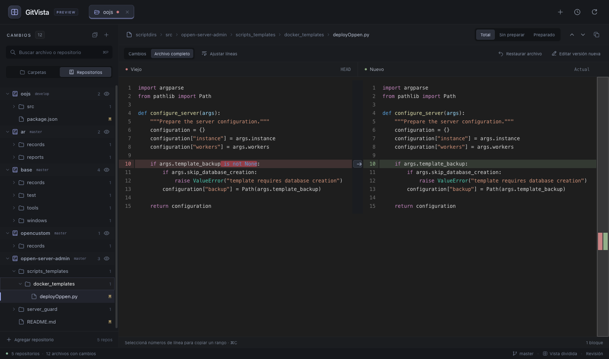

# GitVista

A focused desktop app for reviewing changes across a Git project and its nested repositories. See the original on the left, the updated file on the right, and all changed paths in one tree.

Built with Rust, Tauri 2, Svelte 5 and TypeScript. Licensed under [MIT](LICENSE).



*Browser preview with bundled sample data. The desktop application reads your local repositories. Interface labels are currently in Spanish.*

## What it does

- Discovers nested repositories, worktrees and submodules under one workspace root.
- Groups changes by project folders or independent repositories, with search and per-repo untracked-file visibility.
- Compares **HEAD → working tree**, **index → working tree**, or **HEAD → index**.
- Shows changed blocks or complete files, with syntax highlighting, inline emphasis, optional word wrap and keyboard navigation.
- Lets you explicitly edit the current working file, restore blocks into a draft, and undo before saving.
- Cleans a selected repository through a confirmed, recoverable stash action.
- Keeps multiple root folders in tabs, with one active workspace and one mounted diff.

## Status and platform support

GitVista is an early MVP. The validated desktop target is **macOS on Apple Silicon**; the reference test machine runs macOS 26.6. A minimum supported macOS version has not been established. Intel Macs, Linux and Windows have not been validated for this release.

There are currently **no published binary releases**. Build from source using the instructions below. The local `.app` build does not require an Apple signing account; signed/notarized distribution is future work. See the [roadmap](docs/roadmap.md) and [measured baselines and limitations](docs/validation.md).

## Build and run on macOS

Install these prerequisites first:

- [Node.js](https://nodejs.org/en/download) **22.12 or newer**, with npm.
- [Rust through rustup](https://rustup.rs/). The repository pins **Rust 1.99.0**, including rustfmt and Clippy.
- Xcode Command Line Tools (`xcode-select --install` if missing), and Git available on `PATH`.

Then run:

```sh
git clone https://github.com/pablobesada/gitvista.git
cd gitvista
npm ci
npm run desktop
```

To build and open the optimized desktop app:

```sh
npm run bundle
open target/release/bundle/macos/GitVista.app
```

`npm run dev` starts a browser preview with sample data, without access to local repositories. See [development setup and troubleshooting](docs/development.md) for toolchain checks, commands and platform notes.

## First review

1. Open a root folder with **⌘O**. Nested repositories appear progressively.
2. Select **Carpetas** (folder hierarchy) or **Repositorios** (peer repos), then choose a changed file.
3. Use **Total**, **Sin preparar** or **Preparado** to choose the comparison.
4. Choose **Cambios** for relevant blocks or **Archivo completo** for both full versions.

Review queries do not modify Git's index or configuration. **Guardar** explicitly writes the current working file. **Guardar en stash y limpiar…** explicitly changes the selected repository's working tree and index after confirmation. That action can include untracked files; ignored files and nested working trees are preserved. See the [usage guide](docs/usage.md#save-changes-in-a-stash-and-clean-a-repository) before using cleanup.

## Documentation and contributions

- [Usage guide and keyboard shortcuts](docs/usage.md)
- [Development setup and verification](docs/development.md)
- [Architecture and resource budgets](docs/architecture.md)
- [Validation results and performance limits](docs/validation.md)
- [Roadmap](docs/roadmap.md)
- [Contributing](CONTRIBUTING.md)
- [Security policy and private vulnerability reporting](SECURITY.md)

Bug reports and feature proposals are welcome through [GitHub Issues](https://github.com/pablobesada/gitvista/issues/new/choose). Please read the contribution guide before starting a large change.

Third-party dependencies retain their own licenses, including Apache-2.0 for `@pierre/diffs`.
